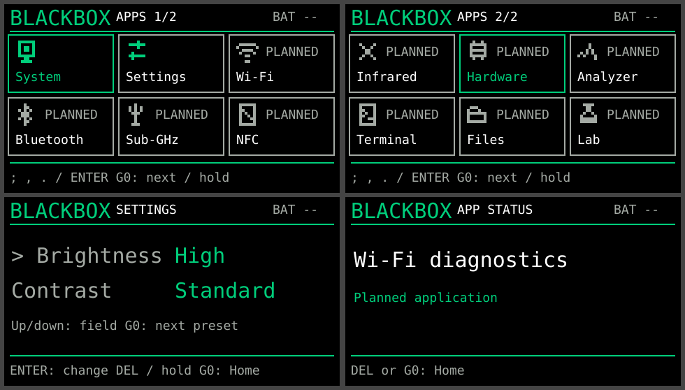

# BLACKBOX OS 0.2.0

## Current RC1 controls

The current dashboard contains 13 apps across three pages. Use the four directions to move and Enter to open. G0 cycles tiles on a tap, selects on a hold, and returns Home after a hold of at least two seconds followed by release. Q opens Search and F opens the configured shortcut. Inside System, Enter advances to Health, Ownership and Self-test. On the Self-test page select once to run the four checks. Delete returns to the overview or exits. Text entry uses the keyboard; G0 can exit editors without entering characters. [RC1 preview](rc-preview.svg) · [Current operator guide](../blackbox/README.md)

The remainder records the original dashboard implementation.

The independent Cardputer ADV project now starts on a two-page, six-tile dashboard. System Info and Settings are available. Gray tiles marked PLANNED open a notice. Their descriptors have no implementation callbacks. No communications or scanning code is included for those entries.



The preview runs the production drawing functions against a host SVG display adapter using approximate fonts and unavailable battery data. Physical display, battery accuracy, PWM and switch timing await device validation.

## Controls

| Location | Keyboard | G0 button |
|---|---|---|
| Dashboard | Semicolon up, comma left, period down, slash right. Enter opens the highlighted tile. Up and down cross page boundaries. | Tap advances cyclically. Hold at least 600 ms and release to open. |
| System Info | Delete returns to the selected tile. | Hold and release to return. |
| Settings | Up/down choose brightness or contrast. Enter or left/right changes its value. Delete returns. | Tap cycles through all six combinations. Hold and release to return. |
| Planned or unavailable | Delete returns. | Tap or hold and release to return. |

Brightness uses 5 kHz PWM on the original backlight pin. Contrast switches secondary text and inactive tile outlines between gray and white. Preferences last until reset and start at high brightness and standard contrast. System Info retains device detection, battery voltage, current free heap, reserved flash capacity and version. The reusable header updates its battery text only when the displayed value changes.

## Register a diagnostic application

1. Define a Lifecycle with enter, refresh, input and leave functions. Enter draws the initial view. Refresh is called once per second while active. Input receives key events after global Back handling, including None on idle iterations, so ignore unhandled keys. Leave releases any resources acquired on entry. Keep callbacks short and bounded.
2. Add an App in registry.cpp with a full name, short tile label, eight bitmap rows, required hardware mask and a pointer to the lifecycle. Each row uses the low eight bits, most significant pixel first. Keep a proposed app reserved by using nullptr. Both active apps require the panel. Battery and flash readings in System Info are optional and have unavailable states.
3. Add new implementation files to the explicit PlatformIO source filter. Advertise a new peripheral in the available mask only after its availability and bus ownership have been established. Navigation checks requirements before calling enter. Firmware currently advertises the configured panel, onboard ADC and presence of the data partition.
4. Update the expected registry inventory in the host tests and exercise entry, unavailable hardware, input and return navigation. Measure the padded app size against the same partition.

## Validation record

Run from repository root:

```sh
c++ -std=c++11 -Wall -Wextra -Werror -Iblackbox/src blackbox/tests/navigation_test.cpp blackbox/src/registry.cpp blackbox/src/navigation.cpp -o /tmp/blackbox-nav-test && /tmp/blackbox-nav-test
pio run -d blackbox -e blackbox-cardputer-adv
```

| Local build measurement | 0.1.0 | 0.2.0 | Change |
|---|---:|---:|---:|
| Padded application bytes | 314,608 | 323,264 | +8,656 |
| Remaining factory app bytes | 4,797,200 | 4,788,544 | −8,656 |
| Static RAM bytes | 19,712 | 19,824 | +112 |
| Compiler warnings / errors | 0 / 0 | 0 / 0 | 0 |

The application occupies 6.32% of the 5,111,808-byte partition. Static RAM is 6.05% of 327,680 bytes. PlatformIO's flash section estimate is 322,893 bytes. No dependency changes. The build used PlatformIO 6.2.0, espressif32 6.10.0, Arduino 2.0.17, Xtensa 8.4.0+2021r2-patch5, TFT_eSPI 2.5.43, Adafruit TCA8418 1.0.2 and BusIO 1.17.2. The existing host Python urllib3/LibreSSL warning recurred.

| Binary | SHA-256 |
|---|---|
| firmware.bin | 91091cd975fe617d1c297c4ab86219b90adb07351a62511058d57b56a9dc35d6 |
| bootloader.bin | 1776e4dd896a69d0a5c2e79957b0e2a88aa4129b1381d6478683515a1f6af343 |
| partitions.bin | 40dc554ae4f93b09fa057db852ff05b3e03d42167fe65a490496def94b3648ec |

Host assertions passed for registry uniqueness, lifecycle presence, bounds, missing requirements, reserved entries, invalid selection recovery, selected-tile preservation, callback dispatch and keyboard/G0 return. esptool verified the application checksum and embedded validation hash. Physical tests remain outstanding for both firmware versions.

## Changed files

Under blackbox/, platformio.ini selects the new source list. src/main.cpp coordinates startup and sampling. src/device.h and src/platform.h declare hardware and app interfaces. src/display.cpp owns the renderer and the two lightweight app views. src/input.cpp decodes keyboard and G0 events, src/status.cpp samples device readings, src/navigation.cpp manages screen transitions and src/registry.cpp declares the tile inventory. tests/navigation_test.cpp runs on a host compiler. docs/DASHBOARD.md and docs/dashboard-preview.svg provide this guide and the interface preview.
