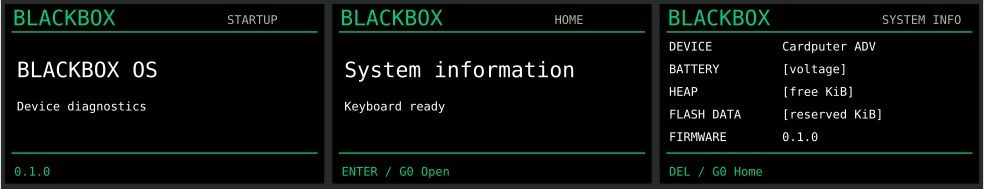

# BLACKBOX OS 0.1.0 foundation

This standalone project builds from blackbox/platformio.ini. From the repository root run `pio run -d blackbox -e blackbox-cardputer-adv`. Review the source filter and the single translation unit in blackbox/src. The project uses Bruce's Cardputer wiring, keyboard matrix and AGPL-3.0-or-later attribution. It has its own Arduino entry points and display loop. The upstream project and hooks are outside its build. Only the keyboard controller is probed.

Startup advances to Home after 850 ms. Enter opens System and Delete returns home. G0 switches between these screens, including when the keyboard probe fails. The system page samples battery divider voltage and free heap once per second. The flash data row reports reserved partition capacity. Filesystem use, SD presence, charging state and battery percentage are unknown. No filesystem is mounted. Display and button behavior, ADC accuracy and controller detection await physical testing.

## Local build evidence

PlatformIO 6.2.0, Python 3.9.6, espressif32 6.10.0, Arduino 2.0.17 (package 3.20017.241212+sha.dcc1105b), Xtensa 8.4.0+2021r2-patch5, esptool 4.5.1. Direct libraries: TFT_eSPI 2.5.43, Adafruit TCA8418 1.0.2 and BusIO 1.17.2. The framework supplies Wire, SPI, FS, SPIFFS and LittleFS. The package manager also fetched SH110X and GFX as declared transitive dependencies; both are excluded from the build.

Compiler and linker succeeded with zero reported compiler errors or warnings. Python emitted a host urllib3 warning about LibreSSL 2.8.3. PlatformIO reported 314,241 flash bytes and 19,712/327,680 bytes static RAM. The padded application is 314,608/5,111,808 bytes (6.15%), leaving 4,797,200 bytes. This is the first measurement for this target. BUILD.md records the separate historical Bruce release.

| Local output | Bytes | SHA-256 |
|---|---:|---|
| firmware.bin | 314608 | 28667c2fea8553d196dadc2c1c6656b7516e50040983a12379dddf48ec0811cb |
| bootloader.bin | 15104 | 1776e4dd896a69d0a5c2e79957b0e2a88aa4129b1381d6478683515a1f6af343 |
| partitions.bin | 3072 | 40dc554ae4f93b09fa057db852ff05b3e03d42167fe65a490496def94b3648ec |

esptool image_info verified the application checksum and validation hash. A temporary C++ host harness exercised the production screen code with simulated device inputs. Assertions covered startup timeout, fallback button debounce, absent keyboard/storage, invalid battery, key release, Enter/Delete navigation, valid readings and unchanged-value redraw suppression. These checks do not exercise the physical display or buses.
