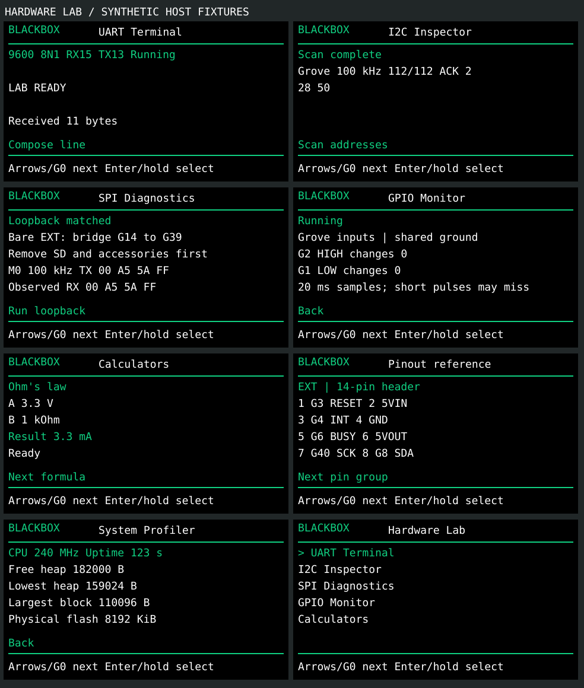

# BLACKBOX OS 0.7.0 · Hardware Lab

Target **M5Stack Cardputer ADV**, based on 0.6.0 commit `f059b18`. The dashboard has separate **Terminal**, **Lab** and **Hardware** (Module Manager) entries. UART, I²C, SPI and GPIO default to deterministic simulation. Select **Change source** to inspect hardware availability. Physical UART RX, external I²C and GPIO sessions are locked pending individual bench confirmation. SPI Diagnostics has an in-memory transaction fixture and a read-only view of the device registry.

## Using the firmware

Use arrows or tap G0 to move focus. Enter or a G0 hold selects the focused action. Delete or the Back action returns to the menu. UART keeps its session when switching between Terminal pages. Returning to the dashboard releases its session and clears its temporary history. Lab instruments release their session when returning to the Lab menu. Sessions also stop on error or after 60 seconds. Source changes stop the current session and clear its results.

| Tool | Operation and interpretation |
|---|---|
| UART Monitor | Explicit Start, Stop, Pause, Resume and Clear. The ASCII and hex viewers share a scrollable ring of 32 observations, each containing up to eight received bytes and an elapsed-millisecond timestamp. ASCII renders nonprintable bytes as dots. Pausing drains input and counts skipped bytes while preserving captured history. Statistics show received bytes, skipped bytes, elapsed time, retained observations and mean bytes/s since Clear. Stop retains the display for review. |
| Serial Config | 8N1 at 9600, 19200, 38400, 57600 or 115200 baud. Change speed while stopped. The gated adapter routes RX to G15 and leaves TX unassigned. The ADV expansion map also assigns G13 to TX. Module Manager reserves the UART profile against the U219 RF pin overlap. The fixture emits a short binary/text observation on 200 ms intervals when polled. Timestamps correspond to application reads. Sustained hardware throughput remains unmeasured. |
| I²C Inspector | Start scans external Grove at the selected 100 or 400 kHz. The graphical map has 16 columns per hexadecimal row. Blank corner cells are reserved addresses, and wide green marks show ACKs. Additional pages show the response list, individual address status, progress and configuration. Each address from 0x08 through 0x77 receives one address-only probe. A transaction timeout (10 ms in the adapter) or unexpected bus error releases the lease. An ACK establishes a response only. The two named fixture devices exist solely in simulation. |
| SPI Diagnostics | The registry pages show the shared expansion SPI controller, CC1101, NFC and SD chip selects, pin assignments, current owner and conflicts. Physical select voltages are unmeasured. The mode-0, MSB-first, nominal 100 kHz fixture shifts four known bytes through a software loopback. Cycle fixtures to model a busy peripheral or MISO held low. The bus diagram shows synthetic select levels in simulation. Hardware Lab sends no physical SPI transaction. |
| GPIO Monitor | Input inventory covers G2 and G1. The two traces retain 32 samples. Edge counters saturate at the unsigned limit. After two observed transitions, the timing page shows the shortest and longest interval between observed changes for each pin. The first partial interval is excluded. Sampling is foreground-driven, at least 20 ms apart, and can miss entire pulses. A separate page lists protected resources and cycles through actual registry owners. |
| Calculators | Select a calculator, cycle the input field, then edit a value or cycle presets. Enter applies a typed value, Delete edits it and G0 cancels text entry. Resistor-band presets cycle valid colors per band. Invalid fields display an error. Numeric and color calculations run entirely offline. |
| Pinout Library / Electronics Ref | Separate paged libraries cover ADV internal and expansion signals, ESP32-S3, Grove, U219 RF and NFC, Unit NFC, RFID2 and infrared. Reference pages cover UART level conversion, I²C pull-ups, SPI modes and selects, electrical symbols and formulas, logic compatibility, pin ownership, sampling and safe bench connections. |
| System Profiler | Device-only pages show current/minimum heap, largest allocatable block, static data plus BSS, CPU frequency, uptime, firmware version, running partition size, image length and remaining capacity. Additional pages show battery voltage, internal radio session owner or fault, selected peripheral ownership, total and per-instrument Lab errors, a 32-sample heap history, foreground poll count and maximum observed poll gap. Missing battery or image readings display unavailable. Fault counters include intentionally exercised simulation faults. |

**Calculator coverage.** Solve Ohm’s law for current, voltage or resistance. Calculate electrical power, series and parallel resistance, unloaded voltage-divider output, LED minimum series resistance, four- and five-band resistor values with tolerance, frequency or period, PWM duty cycle and RC time constant. The integer converter accepts unsigned 32-bit decimal, 0b-prefixed binary and 0x-prefixed hexadecimal and shows all three results. The logic-level page gives the output/input threshold checks. Calculations reject invalid denominators, unsupported bands, nonfinite values, malformed input and values outside supported ranges. Electrical inputs are bounded to magnitude 10¹⁵. The LED result is an ideal minimum; final component choice requires a suitable resistance and power rating. [Vishay resistor color chart](https://www.vishay.com/docs/49411/resistor_color_code_calculator.pdf)

## Hardware evidence and validation still required

- **Identify the assembly first.** Verify K132-Adv revision, connector orientation, 3.3 V signal levels, ground and supply rails with external accessories disconnected. The Grove red conductor is a 5 V supply. UART uses logic-level signaling. RS-232 requires its level converter and RS-485 requires a differential transceiver. The U219 shares expansion signals and power between its RF and NFC sections. [M5Stack ADV pin map](https://docs.m5stack.com/en/core/Cardputer-Adv) · [U219 cap](https://docs.m5stack.com/en/cap/Cap_CC1101) · [U216 Unit NFC](https://docs.m5stack.com/en/unit/Unit_NFC) · [Espressif ESP32-S3 datasheet](https://www.espressif.com/sites/default/files/documentation/esp32-s3_datasheet_en.pdf)
- **Verify the locked build on ADV.** Inspect inactivity at boot and app entry. Check the simulated screens, fonts, keyboard and G0. Check real profiler readings against the image, linker map and independent device observations. Opening the profiler samples genuine firmware values. The published SVG substitutes a host fixture.
- **UART RX, separately reviewed bench build.** With no U219 accessory attached, connect a known 3.3 V transmitter to G15 and common ground. Leave G13 disconnected. Send known ASCII, control and binary bytes from the fixture at each supported rate. Verify timestamps, pause, skipped counts, ring wrap, timeout and exit. Measure the point at which incoming data exceeds service capacity. Verify the ADV never drives TX.
- **I²C and GPIO, separately reviewed bench builds.** Use a known authorized Grove fixture with compatible pull-ups. Verify one probe per permitted address at both speeds, error and timeout handling, and reuse after cancellation. Check G1 and G2 with known low, high and slow pulse inputs. Compare sampled intervals with an independent instrument and test missing transitions at higher frequency. Inspect the shared bus and verify system-owned pins remain protected.
- **SPI and regressions.** Use the software fixture for transactions. Compare registry ownership against Module Manager and verify that physical SPI selects and clock remain inactive when starting a simulated test. Reopen existing applications after cancellation and timeout and measure available heap. Record board/accessory revisions and the firmware hash with bench results.

## Reproduction and host evidence

From the repository root run `sh blackbox/tests/check_nfc_ir.sh`. For a clean compile, run `pio run -d blackbox -t clean`, then `pio run -d blackbox -e blackbox-cardputer-adv`. The 14 host executables passed. They cover release locks, working and failing transport callbacks on an isolated registry, conflict detection, rollback, timeout, cancellation, receive ring boundaries, ASCII/hex formatting, sampled GPIO timing, saturation, calculator defaults and invalid inputs, reference navigation, profiler screens and application lifecycle. The wireless, Sub-GHz and NFC/IR previews reproduced their checked-in SVGs byte for byte. These are software checks. Physical validation is outstanding.

## Clean build measurements

| Metric | Recorded 0.6.0 | Local 0.7.0 | Change |
|---|---:|---:|---:|
| Padded application bytes | 1,264,304 | 1,290,800 | +26,496 |
| Free factory partition bytes | 3,847,504 | 3,821,008 | −26,496 |
| Static RAM bytes | 72,740 | 73,980 | +1,240 |

The partition holds 5,111,808 bytes. The padded application uses 25.25%. PlatformIO reported 1,290,441 linked flash bytes. Static RAM capacity is 327,680 bytes. Compiler diagnostics contained zero warnings and zero errors. The host Python runtime emitted its existing urllib3/LibreSSL warning.

Dependencies match 0.6.0. PlatformIO Core 6.2.0, Espressif32 6.10.0, Arduino ESP32 2.0.17 (3.20017.241212+sha.dcc1105b), Xtensa and RISC-V GCC 8.4.0+2021r2-patch5, esptool 4.5.1, TFT_eSPI 2.5.43, Adafruit TCA8418 1.0.2, BusIO 1.17.2, Wire 2.0.0 and SPI 2.0.0.

| Binary | Bytes | SHA-256 |
|---|---:|---|
| bootloader.bin | 15,104 | `1776e4dd896a69d0a5c2e79957b0e2a88aa4129b1381d6478683515a1f6af343` |
| firmware.bin | 1,290,800 | `adf5943e26ee2ee71b005ebc0c504eb7480d2d9fdbf1396426baeff6c4c392d3` |
| partitions.bin | 3,072 | `40dc554ae4f93b09fa057db852ff05b3e03d42167fe65a490496def94b3648ec` |

## Changed-file inventory relative to 0.6.0

- `AGENTS.md`
- `blackbox/platformio.ini`
- `blackbox/src/bench.cpp`
- `blackbox/src/bench.h`
- `blackbox/src/bench_io.cpp`
- `blackbox/src/bench_offline.cpp`
- `blackbox/src/bench_offline.h`
- `blackbox/src/bench_reference.cpp`
- `blackbox/src/bench_ui.cpp`
- `blackbox/src/device.h`
- `blackbox/src/display.cpp`
- `blackbox/src/input.cpp`
- `blackbox/src/platform.h`
- `blackbox/src/profiles.cpp`
- `blackbox/src/registry.cpp`
- `blackbox/src/wireless_view.h`
- `blackbox/tests/bench_preview.cpp`
- `blackbox/tests/bench_stubs.h`
- `blackbox/tests/bench_test.cpp`
- `blackbox/tests/bench_transport_test.cpp`
- `blackbox/tests/check_nfc_ir.sh`
- `blackbox/tests/lab_profiles_test.cpp`
- `blackbox/tests/modules_test.cpp`
- `blackbox/tests/navigation_test.cpp`
- `blackbox/tests/profile_stubs.h`
- `docs/ARCHITECTURE.md`
- `docs/HARDWARE_LAB.md`
- `docs/ROADMAP.md`
- `docs/hardware-lab-preview.svg`
