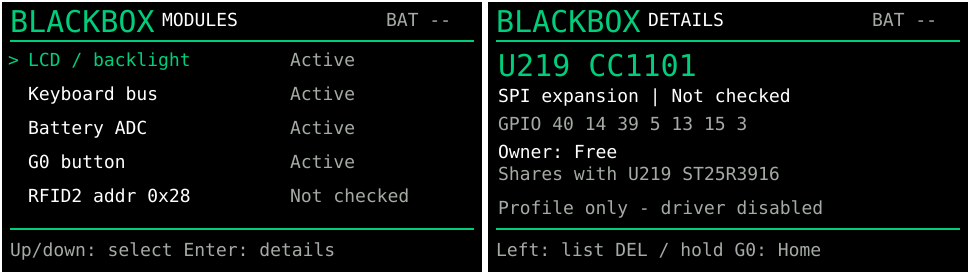

# Hardware Module Manager · BLACKBOX OS 0.3.0

On the second dashboard page, open **Hardware**. Up/down browse nine inventory records. Enter opens details, Left returns to the inventory and Delete returns to the dashboard. G0 taps alternate between details and the next item; hold and release G0 to go home. An external check requires a separate Enter press on the RFID2 detail screen. Opening the app only displays inventory.



## Board and accessory evidence

The compiled target is K132-Adv. A successful onboard TCA8418 initialization selects the ADV profile; a failed probe leaves board identity unknown and blocks external checks. It is a board fingerprint rather than unique product identification. The system retains ownership of the configured panel, keyboard bus, battery ADC and G0. The keyboard, codec and IMU share system I²C; GPIO38 serves the backlight and RGB power. Classic Cardputer wiring is outside this profile. [M5Stack ADV pin map](https://docs.m5stack.com/en/core/Cardputer-Adv)

| Profile | Electrical and wiring evidence | Implemented behavior |
|---|---|---|
| U219 Cap CC1101 | Manufacturer documents a 5 V operating condition and onboard DC-DC converter. ADV expansion SPI uses SCK 40, MOSI 14 and MISO 39. CC1101 uses CS 5, switch 13 and GDO0 15. | Metadata only. No power switching, initialization or RF operations. |
| U219 NFC | The same Cap contains an ST25R3916 on shared SPI, CS 6 and IRQ 4. Both profiles reserve the common power-enable line G3 identified in the fork board definition. | Metadata only. Overlap is displayed even when neither profile owns resources. |
| U031-B Unit RFID2 | Separate WS1850S device. Its HY2.0 connector takes GND and 5 V, yellow SDA and white SCL. On ADV these are G2 and G1. Published 7-bit address is 0x28. | On demand, acquire Grove I²C, initialize at 100 kHz, send only the address, record ACK/NACK/error, and release the controller. No register or tag operations. |
| microSD / EXT UART | SD uses G12 CS on the shared expansion SPI wires. EXT UART maps TX 13 / RX 15 and overlaps the U219 RF section. | Wiring and ownership metadata only. Neither controller is opened by the manager. |

[Cap specifications and pin map](https://docs.m5stack.com/en/cap/Cap_CC1101) · [RFID2 specifications and connector](https://docs.m5stack.com/en/unit/Unit_RFID2) · [Fork board definition](../boards/m5stack-cardputer/m5stack-cardputer.ini)

The model of the user's physical accessory, revision, connector orientation, pull-ups, signal voltages and actual power behavior remain unverified. A module supply rating does not establish GPIO tolerance. Use the documented assembled accessory and connector for any later bench check. Other NFC accessories, including PN532 variants, have no enabled profile. An address ACK indicates only that something responded. The display reports the last explicit check until another check or reboot. A missing keyboard leaves G0 inventory navigation available.

## Resource API

The board owns its startup resources. The capability mask passed to application navigation derives from these reservations and the partition lookup. External descriptors have stable IDs, controller identities, GPIO lists and optional start/stop callbacks. The resource manager uses a fixed table of at most sixteen records, no runtime allocation, and exclusive leases on the single foreground application loop. Background tasks would need synchronization before using this API.

Before starting an external driver, acquire the profile with a distinct non-system owner. The registry rejects unknown boards, disabled callbacks, invalid or repeated pins, occupied controllers and overlapping GPIOs. A successful callback changes the lease to Active. A failed callback invokes cleanup and relinquishes the lease. Release transitions to Available; another owner's release is ignored. The app's leave callback cleans up its outstanding leases. Callback pairs must support cleanup after partial initialization. SPI and UART support here covers resource arbitration; this release supplies no external SPI/UART transport drivers. Idle shared buses are shown as potential overlaps. Visible Conflict means a current reservation would prevent the claim. Built-in Active means the board has reserved that hardware; it does not certify a healthy device.

## Validation

| Local measurement | 0.2.0 | 0.3.0 | Change |
|---|---:|---:|---:|
| Padded application bytes | 323,264 | 326,192 | +2,928 |
| Remaining application bytes | 4,788,544 | 4,785,616 | −2,928 |
| Static RAM bytes | 19,824 | 19,976 | +152 |
| Compiler warnings / errors | 0 / 0 | 0 / 0 | 0 |

Partition capacity is 5,111,808 bytes. PlatformIO estimated 325,825 flash bytes before image padding. Dependencies are unchanged: PlatformIO 6.2.0, espressif32 6.10.0, Arduino 2.0.17, Xtensa 8.4.0+2021r2-patch5, esptool 4.5.1, TFT_eSPI 2.5.43, TCA8418 1.0.2 and BusIO 1.17.2. Host Python 3.9.6 emitted the existing urllib3/LibreSSL warning.

| Local output | Bytes | SHA-256 |
|---|---:|---|
| firmware.bin | 326192 | 5b1ec238ca058e92e7744147af154a532f3aafa509881032dc5fd1b6cf72e201 |
| bootloader.bin | 15104 | 1776e4dd896a69d0a5c2e79957b0e2a88aa4129b1381d6478683515a1f6af343 |
| partitions.bin | 3072 | 40dc554ae4f93b09fa057db852ff05b3e03d42167fe65a490496def94b3648ec |

The ESP32-S3 build succeeded; esptool verified the application checksum and embedded validation hash. Both host assertion suites passed. Simulated cases cover competing pin/controller claims, duplicate pins, invalid pins/IDs, missing modules, unknown hardware, failed starts, retry, owner isolation, cleanup and return to the selected dashboard tile. The SVG uses production rendering with simulated board status. No device was flashed and no physical peripheral was tested.

From the repository root:

```sh
cd blackbox
c++ -std=c++11 -Wall -Wextra -Werror -Isrc tests/modules_test.cpp src/modules.cpp src/navigation.cpp src/registry.cpp -o /tmp/bb-modules && /tmp/bb-modules
c++ -std=c++11 -Wall -Wextra -Werror -Isrc tests/navigation_test.cpp src/navigation.cpp src/registry.cpp -o /tmp/bb-navigation && /tmp/bb-navigation
pio run -e blackbox-cardputer-adv
```

Changed files under blackbox/: platformio.ini selects the new sources; src/modules.h and src/modules.cpp define identity, descriptors, status and arbitration; src/profiles.cpp supplies the ADV inventory, capabilities and bounded Grove check; src/main.cpp registers board reservations; src/display.cpp implements inventory and details; src/device.h, src/platform.h and src/registry.cpp publish the version and app. tests/modules_test.cpp and tests/navigation_test.cpp cover resource and dashboard behavior. docs/MODULES.md and docs/modules-preview.svg record the review evidence.
