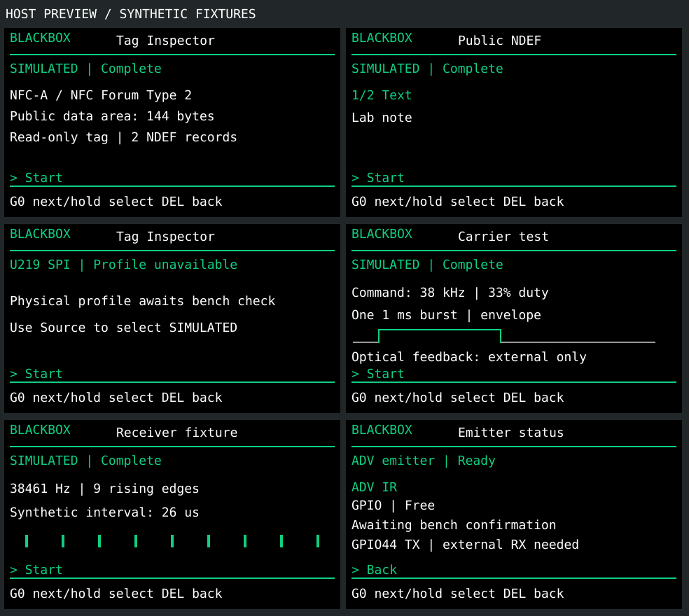

# NFC Center and Infrared Lab · BLACKBOX OS 0.6.0

**Available now:** both dashboard apps, deterministic simulations, and Module Manager inventory. The release image locks all three new physical profiles. The SPI, I²C and emitter drivers were compiled and exercised against host fixtures. Electrical, RF, optical and on-device UI validation remain open. The source baseline is `feature/blackbox-subghz` at `3bb9796cbb0617854ff0d5e1f7e27bdfb5cc62a6`.

## Reviewing the apps

- **NFC Center** opens with the U219 source selected. Move to **Source** and select it to cycle through U216 and SIMULATED. Select **Tag Inspector → Start**. The fixture contains a 144-byte NFC Forum Type 2 data area, a public text record and a URI. Back returns to the menu. **Public NDEF** retains a completed result while the app is open. Select **Next record** to browse. URIs are displayed as text.
- **Infrared Lab** opens with the ADV emitter selected. Switch **Source** to SIMULATED and start **Carrier test** to see the commanded envelope. **Receiver fixture** calculates the interval and frequency from nine deterministic synthetic rising edges. The hardware source requires a separate receiver for optical feedback. No external receiver profile was sufficiently verified for inclusion.
- Use arrows or tap G0 to move focus. Enter or hold G0 selects the focused action. Back, Delete and the dashboard action follow the existing navigation lifecycle. Starting a hardware session requires a separate Start action. Opening a status screen reads the ownership registry and last diagnostic state.
- Stop, Back, expiry, faults and app exit release active leases. A completed tag view holds the public record summaries until the next start, source change or app exit. Credentials, UIDs, raw tag pages and private records have no export, log or storage path. The protocol uses temporary NFC-A selection bytes during the transaction.

## NFC scope and limits

The register driver checks the ST25R3916 chip type, brings up the oscillator and uses NFC-A reader mode with a single tag. It polls the interrupt status registers. It rejects collisions and framing faults. It supports Type 2 tags with a version 1.0 Capability Container that advertises free reading. It accepts the standard writable and read-only access values. Capacity is the advertised Type 2 data area, expressed in bytes. The driver reads the capability block first, then reads 16-byte data blocks within the advertised area. With restricted read access it stops before requesting the data area.

The public viewer handles a leading NDEF TLV with optional NULL padding, up to 128 message bytes, four unchunked records and 64 display characters per record. It displays printable ASCII from UTF-8 text and common HTTP/HTTPS URI prefixes. Other bytes render as question marks. Other record types and UTF-16 text show a type label. Invalid lengths, malformed message boundaries, unsupported layouts, control TLVs and large or chunked messages stop the read or report an unsupported format. A long-NDEF-length field inside a record is supported within the message bound. Extended TLV lengths and complex reserved-memory layouts are outside this implementation. Only complete in-range 16-byte reads are issued.

A session has a three-second deadline. The oscillator wait has a 15 ms limit and register access over I²C uses a 5 ms bus timeout. A missing tag can be polled again within the same explicitly started session. A missing response after selection ends the session. Shutdown requests standby and checks the control register. If standby cannot be confirmed, reader diagnostics retains that condition. The U216 is powered by the Grove supply, so a disconnected or wedged bus can prevent confirmation of field shutdown.

## Physical profiles

| Profile | Connection and resources | Validation boundary |
|---|---|---|
| M5Stack U219 Cap CC1101, NFC section | Assembled 5 V cap on the ADV 14-pin connector. ST25R3916, onboard antenna, expansion SPI at 1 MHz, mode 1. GPIO40 SCK, 14 MOSI, 39 MISO, 6 NFC CS, 4 IRQ, 3 common power enable. GPIO5 and 12 deselect CC1101 and SD. | One exclusive lease covers expansion SPI and all eight GPIOs. Startup and menu entry leave the cap inactive. |
| M5Stack U216 Unit NFC | Assembled ST25R3916 accessory with a straight HY2.0-4P cable. Black GND, red 5 V, yellow SDA on GPIO2, white SCL on GPIO1. Grove I²C at 100 kHz, 7-bit address 0x50. | Independent of system Wire1. Shares the Grove controller with U031-B Unit RFID2. The existing U031-B WS1850S address check remains available through Hardware. |
| M5Stack K132-Adv emitter | Manufacturer lists a single onboard IR transmitter on GPIO44. The diagnostic driver leases that pin and uses ESP32-S3 RMT TX channel 0. | One non-looping item commands 1 ms of 38 kHz carrier at 33% duty followed by 1 ms idle. The hardware envelope ends independently of UI refresh. A 20 ms completion watchdog releases the driver if completion stalls. GPIO drive polarity and optical output await bench confirmation. |

Board identification uses the existing keyboard-based ADV fingerprint. The product pin map and connector names describe specific assemblies. An address ACK alone cannot establish a reader's identity or electrical compatibility. [ADV pin map and specifications](https://docs.m5stack.com/en/core/Cardputer-Adv) · [U219 documentation](https://docs.m5stack.com/en/cap/Cap_CC1101) · [U216 documentation](https://docs.m5stack.com/en/unit/Unit_NFC) · [U031-B documentation](https://docs.m5stack.com/en/unit/Unit_RFID2) · [ST25R3916 register and interface reference](https://www.st.com/resource/en/datasheet/st25r3916.pdf)

## Outstanding bench validation

1. Identify the actual ADV and accessory PCB revisions with power disconnected. Check the ADV, U219 and U216 schematics against the connector wiring. Verify rail voltages, GPIO levels, pull-ups and inactive chip selects. For U219 confirm G3 polarity and idle bias, shared-cap power behavior and SD deselection. For U216 confirm that the 5 V supply and I²C pull-ups are appropriate for the 3.3 V controller. Record the revisions before considering a separately reviewed bench build. [ADV schematic](https://m5stack-doc.oss-cn-shenzhen.aliyuncs.com/1178/Sch_M5CardputerAdv_v1.0_2025_06_20_17_19_58.pdf) · [U219 schematic](https://m5stack-doc.oss-cn-shenzhen.aliyuncs.com/1250/SCH_Cap_CC1101_SCH_V0.3_20260528.pdf) · [U216 schematic](https://m5stack-doc.oss-cn-shenzhen.aliyuncs.com/1229/SCH_Unit_NFC_V0.1_2025_11_28_12_15_35.pdf)
2. On a supervised NFC bench, verify no peripheral activation at boot or app entry. Verify chip identity, oscillator start, field activation and standby on the actual module. Use one known public Type 2 NDEF test tag, an empty tag and a tag that denies free reading. Compare capacity and record contents against the fixture's known data. Exercise missing tags, multiple tags, cancellation, timeouts and repeated starts. Confirm absence of tag writes with the bus trace and before/after tag comparison.
3. Observe CC1101 and SD chip selects during U219 use. Check refused concurrent claims and verify SD, Sub-GHz and Grove recovery after exit. Disconnect a reader during a session and inspect the error, lease release and reader field with a pickup loop. Confirm that the powered U216 enters standby when reachable.
4. Confirm GPIO44 drive polarity and idle level on the actual board. Use a photodiode and oscilloscope or a characterized external receiver to observe a single carrier burst. Check frequency, duty cycle, duration, cancellation, idle state and absence of additional bursts after a key release. A demodulating receiver can verify the envelope; a sufficiently fast optical detector is needed to measure carrier duty cycle.
5. Review all pages on the physical 240×135 display using keyboard and G0. Reopen the existing applications, check RAM recovery, and confirm temporary tag contents clear when leaving NFC Center.

## Validation and reproduction

From the repository root, run `sh blackbox/tests/check_nfc_ir.sh` for the host suites and `pio run -d blackbox -e blackbox-cardputer-adv` for a compile-only build. The eleven host executables passed. The test runner compares all three preview SVGs with the checked-in files. NFC and IR previews call the same application lifecycle and drawing functions used on the device with an SVG drawing surface.

| Checks | Evidence |
|---|---|
| NFC parsing and metadata | Capability Container permissions and capacity, multi-record text and URI, short and normal record lengths, truncation, invalid language length, message and record limits, and reserved TLVs |
| Hardware and cleanup | Production release profile locks, real module registry conflicts, unknown board, SPI and I²C register fixtures, chip identity failure, oscillator timeout, protected-area rejection, lease rollback, timeout across clock rollover, cancellation and app exit |
| IR | RMT fixture checks channel, output pin, carrier, duty, finite item, nonblocking submission, busy driver, configuration failure, stop and pin release |
| Regressions | Navigation, Module Manager, wireless sessions and U219 RF suites passed. Wireless and Sub-GHz preview output reproduced byte for byte. |

The change adds the two registry entries, shared session and UI code, a bounded NDEF parser, ST25R3916 SPI/I²C transport, an RMT emitter, inventory changes, tests and the preview. The independent PlatformIO target still selects its source files explicitly. New code carries the repository's AGPL notice.

## Local release build

| Metric | Recorded 0.5.0 | Clean 0.6.0 | Change |
|---|---:|---:|---:|
| Padded application file | 1,255,984 B | 1,264,304 B | +8,320 B |
| Remaining factory partition | 3,855,824 B | 3,847,504 B | −8,320 B |
| Static RAM | 72,164 B | 72,740 B | +576 B |

Application partition capacity is 5,111,808 bytes. The padded file occupies 24.73%. PlatformIO reported 1,263,933 linked flash bytes. Static RAM capacity is 327,680 bytes. Compiler diagnostics contained zero errors and zero warnings. Python emitted the existing urllib3/LibreSSL warning during the build.

PlatformIO Core 6.2.0, Espressif32 6.10.0, Arduino ESP32 2.0.17 (3.20017.241212+sha.dcc1105b), Xtensa and RISC-V 8.4.0+2021r2-patch5, esptool 4.5.1, TFT_eSPI 2.5.43, Adafruit TCA8418 1.0.2 and BusIO 1.17.2. The dependency graph includes Wire 2.0.0 and now explicitly lists framework SPI 2.0.0. RMT comes from the bundled ESP-IDF driver. No additional third-party library was linked.

| Binary | Bytes | SHA-256 |
|---|---:|---|
| bootloader.bin | 15,104 | `1776e4dd896a69d0a5c2e79957b0e2a88aa4129b1381d6478683515a1f6af343` |
| firmware.bin | 1,264,304 | `a2ba972df7468828103ae850b1d68f99a818fadb2b2b52be2e83e54f06559843` |
| partitions.bin | 3,072 | `40dc554ae4f93b09fa057db852ff05b3e03d42167fe65a490496def94b3648ec` |
