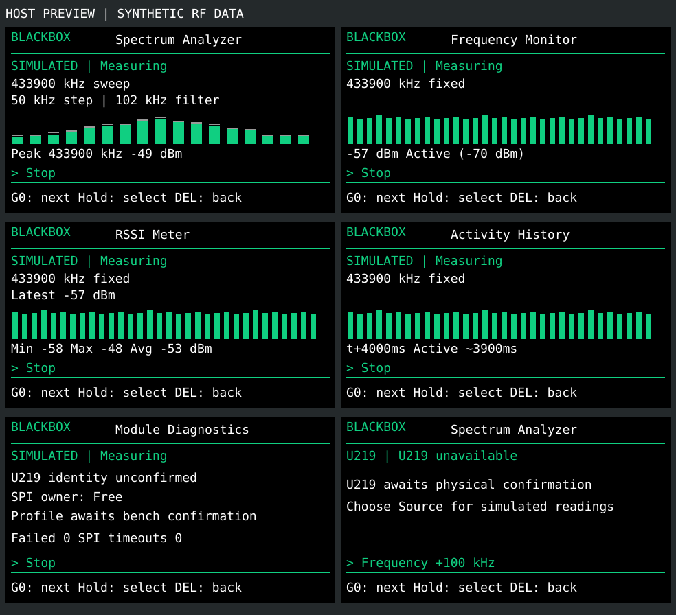

# CC1101 Signal Center · BLACKBOX OS 0.5.0

Open **Sub-GHz** on the dashboard. The initial source is U219. The standard image disables its hardware callback until the accessory and electrical behavior have been confirmed on a bench. Opening any screen leaves all external pins alone. To review the application today, scroll to **Source**, select **SIMULATED**, choose a measurement, then select **Start**. The source is visible throughout each session. Use arrows or tap G0 to move between actions, Enter or hold G0 to select, and Delete or the Back action to return. Dashboard is also a selectable menu item.



## Measurements

| Screen | What it measures or displays |
|---|---|
| Spectrum Analyzer | Sequential 17-bin sweep. Select 50 or 100 kHz spacing for an 800 or 1,600 kHz span. Green bars show the latest bin readings, gray marks retain each bin's maximum and the readout identifies the session peak. |
| Frequency Monitor | Tune within 433.000–435.000 MHz on a 100 kHz selection grid. Read the latest estimated dBm and see whether it reaches the −70 dBm activity threshold. |
| RSSI Meter | Latest estimated dBm plus minimum, maximum and integer average over the most recent 32 samples. |
| Activity History | Last 32 readings, latest sample time since Start, and estimated total active milliseconds. Duration accumulates intervals with both endpoints above or equal to threshold. |
| Module Diagnostics | Last identity read, expansion SPI owner, conflicts, bench profile status, failed operations and chip-ready timeouts. Counters cover this boot. |

Each session stops after 30 seconds or on Stop, Back or fault. Sampling waits at least 100 ms between observations. Each sweep takes at least 1.7 seconds. The nominal RX filter is 101.6 kHz. Adjacent bins can overlap, and short signals can occur between observations. The reported peak is a sampled bin center. RSSI uses a nominal 74 dB offset and integer dBm, pending calibration. Duration is an estimate of energy above a threshold. It cannot identify a protocol or sender. Session data stays in fixed RAM buffers and clears on exit from the view. The UI refreshes live readings once per second.

## Accessory and resource ownership

Use the assembled M5Stack U219 Cap CC1101, Cardputer ADV 14-pin connector and supplied 433 MHz RP-SMA antenna. The cap accepts 5 V and regulates its internal logic supply to 3.3 V. The 433 MHz path uses RF_SW0 high and RF_SW1 low. The board routes the second switch control to CC1101 GDO2 and uses a 26 MHz crystal. The other antenna paths remain outside this profile. [M5Stack U219 pin map and switch table](https://docs.m5stack.com/en/cap/Cap_CC1101) · [U219 schematic, rev 0.3](https://m5stack-doc.oss-cn-shenzhen.aliyuncs.com/1250/SCH_Cap_CC1101_SCH_V0.3_20260528.pdf)

| ADV GPIO | Function during an explicit hardware session |
|---|---|
| 40 / 14 / 39 | Software SPI clock / MOSI / MISO, mode 0, MSB first, at least 1 µs each half-cycle |
| 5 / 13 / 15 | CC1101 chip select / RF_SW0 / reserved GDO0 |
| 3 | Common cap power enable |
| 6 / 12 | NFC and microSD chip selects held high during SPI access |

Module Manager reserves all nine pins and expansion SPI together. The SD and NFC profiles share that bus, and expansion UART overlaps GPIO13/15. The trial driver accepts only PARTNUM 00 and VERSION 14. Each ready wait is limited to 2 ms. The receiver bypasses the packet FIFO, checks RX state before reading RSSI, and uses an IDLE and sleep sequence for a recognized chip at release. Failure cleanup drops power enable, returns driven pins to inputs, and releases the lease. NFC shares the physical supply and has no software initialization. TX, packet decoding and persistent capture have no entry points. [TI CC1101 datasheet, register and RSSI descriptions](https://www.ti.com/lit/ds/symlink/cc1101.pdf)

## Bench work outstanding

1. With the devices powered off, identify the ADV and U219 hardware revisions, inspect connector orientation and attach the 433 MHz antenna. Confirm schematic continuity, shared selects, logic levels and the power-enable polarity and idle bias on the actual assembly.
2. After electrical confirmation, a separate supervised bench build may set BLACKBOX_BENCH_CONFIRMED_U219=1. Verify inactive SPI at boot and on entry, 5 V and regulated 3.3 V supplies, exclusive chip selects, clock timing, part/revision reads and actual RF switch levels. Confirm idle and safe power behavior when GPIO3 returns to input.
3. Compare fixed-frequency readings and both sweep spans with a known-level lab source and calibrated reference. Check frequency error, RSSI offset, sensitivity, settling time, filter width and missed short events.
4. Exercise missing accessory, explicit Stop, timeout, repeated entry/exit, SPI conflict and wrong identity. Verify pin release, NFC deselection, SD and UART usability, battery status, display readability, keyboard and G0 behavior. Record evidence before changing release defaults.

## Reproduction and review

Build from the repository root with `pio run -d blackbox -e blackbox-cardputer-adv`. For host validation, run these commands from `blackbox/`.

```sh
c++ -std=c++11 -Wall -Wextra -Werror -Isrc tests/signal_test.cpp src/signal.cpp -o /tmp/signal-test && /tmp/signal-test
c++ -std=c++11 -Wall -Wextra -Werror -DBLACKBOX_BENCH_CONFIRMED_U219=1 -Itests/gpio_fixture -Isrc tests/u219_test.cpp src/signal.cpp src/u219.cpp src/modules.cpp -o /tmp/u219-test && /tmp/u219-test
c++ -std=c++11 -Wall -Wextra -Werror -Isrc tests/signal_preview.cpp src/signal.cpp src/signal_ui.cpp src/modules.cpp -o /tmp/signal-preview && /tmp/signal-preview > /tmp/signal-preview.svg
```

The session suite covers frequency/span bounds, deterministic samples, peak hold, ring wrap, activity duration, time rollover, cancellation, failed tunes and failed reads. GPIO fixtures exercise the production bench driver and manager together, including no bus access on conflict or unknown board, absent MISO response, unsupported identity, RX status and RSSI conversion, opcode restrictions, failure rollback and pin release. Existing navigation, modules and wireless suites passed. The wireless production preview reproduced the previous SVG byte for byte. All RF signals and GPIO responses used for these checks were simulated.

The implementation lives in signal.cpp (measurement session), u219.cpp (hardware transport), signal_ui.cpp (production screens) and subghz.h (shared interface). The PlatformIO allowlist, app registry, version, module descriptors, claim validation and Module Manager routing integrate them. Host tests and the shared preview canvas live in blackbox/tests.

## Local release build

Base commit `b4e496e640466d0d5ae39380b945e57d2880cb5e`. A clean release build completed with zero compiler errors or warnings. Python emitted the existing urllib3/LibreSSL host warning. PlatformIO reported 1,255,613 linked flash bytes. Partition accounting below uses the padded application file.

| Metric | 0.4.0 recorded build | 0.5.0 local build | Change |
|---|---:|---:|---:|
| Application bytes | 1,250,848 | 1,255,984 | +5,136 |
| Free in 5,111,808-byte partition | 3,860,960 | 3,855,824 | −5,136 |
| Static RAM bytes | 71,660 | 72,164 | +504 |

The application uses 24.57% of its partition. Static RAM uses 22.0% of 327,680 bytes. Dependencies match 0.4.0. PlatformIO Core 6.2.0, Espressif32 6.10.0, Arduino ESP32 2.0.17 (package 3.20017.241212+sha.dcc1105b), Xtensa and RISC-V toolchains 8.4.0+2021r2-patch5, esptool 4.5.1, TFT_eSPI 2.5.43, Adafruit TCA8418 1.0.2, BusIO 1.17.2 and Wire 2.0.0.

| Binary | Bytes | SHA-256 |
|---|---:|---|
| bootloader.bin | 15,104 | `1776e4dd896a69d0a5c2e79957b0e2a88aa4129b1381d6478683515a1f6af343` |
| firmware.bin | 1,255,984 | `fce69c461b89b32c91ae9559cb20375f9433d9cf7986c4f1397d7dc974934782` |
| partitions.bin | 3,072 | `40dc554ae4f93b09fa057db852ff05b3e03d42167fe65a490496def94b3648ec` |
