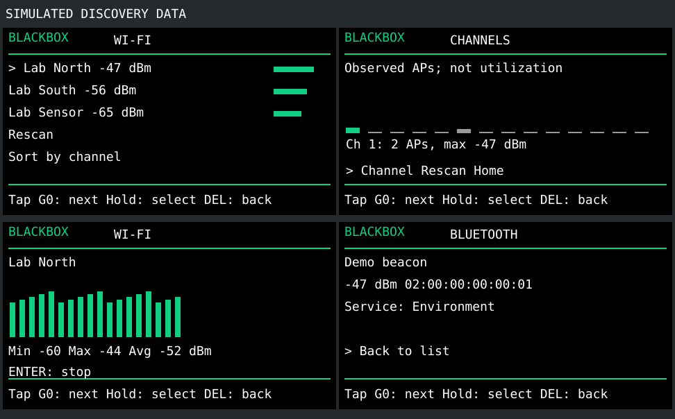

# BLACKBOX OS 0.4.0 · Internal radio diagnostics

Open **Wi-Fi**, **Bluetooth**, or **Analyzer**, then choose **Start passive scan**. Enter or a G0 hold selects. Direction keys and G0 taps move through actions. Delete backs out; on the opening menu it returns home. G0-only users can select Dashboard. Back or Cancel during discovery shuts down the session. External radio and NFC profiles are unchanged.

| Application | What the screen measures |
|---|---|
| Wi-Fi Explorer | A snapshot of advertised APs, strongest first. Open a row for the full printable SSID, BSSID, RSSI, primary channel and advertised security. Scroll below the results for Rescan and sorting. |
| Channel Analyzer | Distribution of retained APs across channels 1–14. Highlight a channel for its count and highest observed RSSI. Left/right or the Channel action moves the highlight. Rescan replaces the snapshot. AP counts do not measure utilization, interference or airtime. A missing AP may have been missed during the dwell or excluded by regulatory channel limits or the result cap. |
| Signal Meter | From a Wi-Fi detail screen, select Lab signal meter, then explicitly choose Start for an AP you are authorized to monitor. Up to 30 passive scans target its BSSID and original channel at about one-second intervals. The graph, integer mean, minimum and maximum use only matching observations. Missing beacons add no synthetic reading. RSSI is receiver-relative and varies with orientation and multipath. |
| Bluetooth Explorer | Five seconds of passive advertisements. Address and address type identify duplicates within this session. Detail shows advertised name, RSSI and one advertised service summary when recognized. Rotating addresses may appear separately. Names sent only in scan responses can be absent. No pairing, connection or service interrogation. |



## Lifetime and data handling

Wi-Fi Explorer, Channel Analyzer, Signal Meter and Bluetooth Explorer have separate owner IDs. One session at a time owns the shared radio. Entry only draws the menu. Starts, expiry, cancellation, partial initialization and app exit converge on the same cleanup path. Wi-Fi uses station mode with RAM configuration, no connection request, and ESP-IDF passive scan type. BLE uses passive GAP scanning with an allow-all filter; no advertising or connection is started. The controller retains the ability to initialize again after shutdown. The shared ESP networking/event-loop infrastructure can remain initialized after first use.

Each discovery has a 12-second foreground deadline. The meter has a 38-second deadline. Polling and callbacks are asynchronous for discovery; initialization and teardown call synchronous SDK functions, so hardware tests must measure latency there. The manager samples free heap while active; the busy screen shows the lowest observed value. A failed shutdown latches a radio error until reboot.

AP results use at most 32 SDK records copied into fixed storage. The SDK can allocate internal scan memory until retrieval or cancellation. BLE uses a fixed 32-result table, coalesces duplicates and favors stronger observations at capacity. The UI stores no client traffic, credentials, raw advertisements or persistent scan history. Names are bounded to 32 bytes with non-printable/non-ASCII bytes shown as question marks. The meter uses a 32-slot sample ring. Result buffers are reset on app exit.

## Local validation

Source baseline dadc72d. Build: `pio run -d blackbox -e blackbox-cardputer-adv`. PlatformIO 6.2.0, Espressif32 6.10.0, Arduino 2.0.17, Xtensa 8.4.0+2021r2-patch5 and esptool 4.5.1. No new downloaded library dependencies. The target now links the existing framework's Wi-Fi and Bluedroid/controller components. TFT_eSPI 2.5.43, TCA8418 1.0.2 and BusIO 1.17.2 remain pinned.

| Local metric | 0.3.0 | 0.4.0 | Change |
|---|---:|---:|---:|
| Padded application bytes | 326,192 | 1,250,848 | +924,656 |
| Remaining factory partition bytes | 4,785,616 | 3,860,960 | −924,656 |
| Static RAM bytes | 19,976 | 71,660 | +51,684 |
| Compiler errors / warnings | 0 / 0 | 0 / 0 | 0 |

Application capacity is 5,111,808 bytes; static RAM budget is 327,680. Runtime stack allocations are additional. Python emitted the existing urllib3/LibreSSL host warning. The image checksum and embedded validation hash passed esptool verification.

| Generated file | SHA-256 |
|---|---|
| firmware.bin | 4daa21b52ef694a6944615c190b755d83629f65f1ee88858c366054eb95e63d7 |
| partitions.bin | 40dc554ae4f93b09fa057db852ff05b3e03d42167fe65a490496def94b3648ec |
| bootloader.bin | 1776e4dd896a69d0a5c2e79957b0e2a88aa4129b1381d6478683515a1f6af343 |

Host tests passed for sorting, truncation, duplicate merging, sample wrap and statistics, exclusive ownership, wrong-owner cancellation, timeout across clock rollover, initialization rollback and shutdown-failure lockout. Existing module and navigation suites passed with the updated app registry. The preview fixture exercised the production view functions, including explicit meter confirmation, using synthetic Wi-Fi and BLE records.

To repeat wireless checks from blackbox/:

```sh
c++ -std=c++11 -Wall -Wextra -Werror -Isrc tests/wireless_test.cpp src/wireless_model.cpp -o /tmp/bb-radio-test && /tmp/bb-radio-test
c++ -std=c++11 -Wall -Wextra -Werror -Isrc tests/wireless_preview.cpp src/wireless_model.cpp src/wireless_ui.cpp -o /tmp/bb-radio-preview && /tmp/bb-radio-preview > /tmp/wireless-preview.svg
```

## Physical validation outstanding

On a Cardputer ADV, confirm idle radio behavior from boot, successful starts and repeated Wi-Fi/BLE handoffs, heap recovery and responsiveness during cancellation. With known lab transmitters, compare advertised names, channel, security and service summaries, check disappearance and channel changes during metering, and exercise empty scans, dense environments, dashboard return, G0 and display timing. There are no device measurements in this report.

The main changes are in blackbox/src/radio.cpp (ESP-IDF integration), wireless_model.cpp and wireless.h (session, samples and records), and wireless_ui.cpp and wireless_view.h (screens and drawing interface). Existing project, navigation, registry, capability, display, loop and version files wire in those components. Host suites and preview sources live in blackbox/tests.
