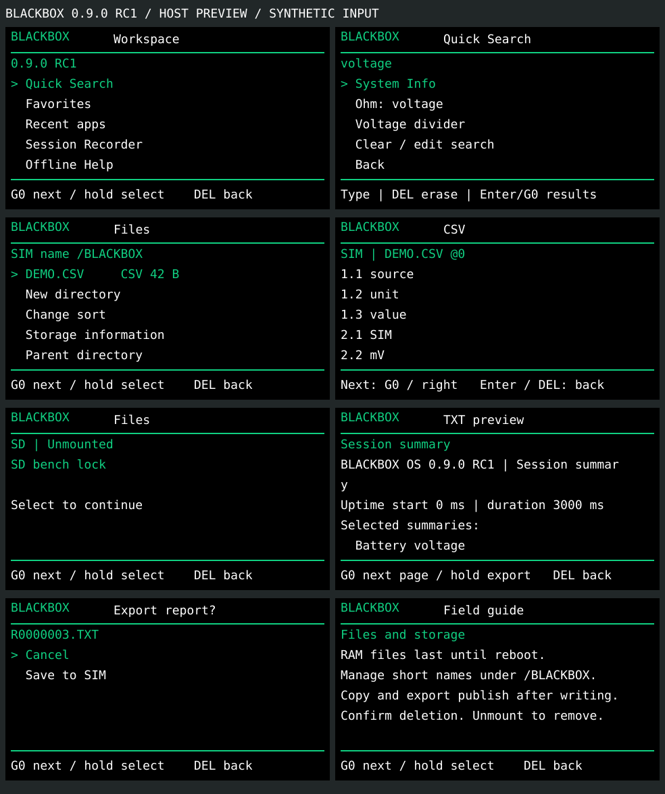

# BLACKBOX OS 0.8.0 on Cardputer ADV

The Files application and Workspace launcher are available on the dashboard. This release was clean-built from the independent target on 24 November 2026. Its parent is the Hardware Lab release at `e77b6c0c35892ddd70b033ac924bdefdff208ace`. Files and report export work with the volatile RAM volume. Internal preferences use ESP32 NVS. The microSD profile requires a separate bench qualification before enabling its physical mount callback.

## Reviewing the interface

1. On the dashboard press **Q** to search or open the Workspace tile. Type part of an app, tool, calculator or reference name. Enter switches from typing to result selection. Use the direction keys to move and Enter to open. DEL edits or goes back. An empty search lists all destinations. G0 tap advances, and hold selects.
2. Open **Workspace → Preferences** to choose the theme and the app assigned to **F** on the dashboard. Manage up to six favorites. Recent apps show the six most recently opened destinations by app ID. Search text and tool targets stay out of history.
3. Open **Files → Mount RAM simulation**. Select `DEMO.CSV` to browse synthetic fields by row and column. File actions include a bounded hex view. Folder and file commands appear in the scrolling list. A name editor accepts keyboard input and DEL. Hold G0 or press Enter to apply the displayed name. Tap G0 to cancel editing.
4. Open **Workspace → Session Recorder → Select summary sources**. Select groups, return to the recorder and choose Start. Run the desired tools, return to the recorder and choose Stop. Select the destination and mount it, choose TXT or CSV, preview the session, then select Export and confirm Save. The default confirmation choice is Cancel. A successful export leaves the summary available for a second format until explicitly discarded.
5. Device health and storage/resource reports are immediate snapshots. Their previews do not start a recorder session. The offline guide covers controls, each application, board connections, sampling limits, storage, troubleshooting and manual firmware recovery.

The eight panels below are produced by operating the production screens with host fixtures. The figures, timings and screenshots in the preview use synthetic inputs. The shared host display adapter substitutes SVG text for TFT glyphs.



## Storage and ownership

| Component | Behavior in this build |
|---|---|
| Internal NVS | One 28-byte versioned preference packet in namespace `blackbox`. Checks cover record length, version, checksum, numeric ranges, ID validity, compact lists and duplicates. Invalid data loads defaults. |
| RAM simulation | 8,192 shared data bytes and 24 node slots including the root. The deterministic CSV fixture is seeded once per boot. Unmount releases the client and preserves files in RAM. Reboot loses all simulated files. |
| Physical microSD | The production profile has disabled start/stop callbacks. The card adapter checks the Module Manager, supports explicit mount/unmount and capacity queries, and passes `false` for format-on-failure. |
| Workspace boundary | All public file actions validate absolute paths under `/BLACKBOX`. Names use 1–8 ASCII letters, digits, hyphens or underscores, plus an optional 1–3 character extension. Maximum path length is 79 bytes. Directory navigation stops at the root. |
| Browsing and viewers | Directories sort first, then by case-insensitive name or descending size. Up to 32 supported entries are displayed per directory. The SD adapter inspects at most 64 entries and signals a limited listing. Text and CSV read at most 128 bytes per page, hex at most 40. CSV tracks quotes and column position across chunks. |
| File changes | Rename and copy reject existing destinations. The UI copies files to a sibling name. Deletion requires confirmation and directories must be empty. Files are always opened as data. |
| Interrupted operations | Copy and export share a 128-byte-per-tick writer. It checks the short write, staged size and destination before renaming. Cancellation removes the current staging file when media is available. After removal or reset, a surviving `BBSTAGE.TMP` blocks new copies and exports. In Files choose **Recover interrupted file** to keep the partial contents under an available `PARTnnnn.TMP` name. |
| Export names | `Rnnnnnnn.TXT` or `.CSV` derives from uptime seconds. Up to 64 alternatives are checked for collisions. Times use the 32-bit uptime counter in milliseconds, which wraps after about 49.7 days. |

The ADV microSD socket uses G12 for chip select, G14 for MOSI, G40 for clock and G39 for MISO. U219 shares those three data/clock signals and uses G5 for CC1101 select and G6 for NFC select. The SD profile claims all six pins and the expansion SPI bus. The compiled adapter assigns the separate expansion SPI controller, deselects the other devices and releases the bus on close or failed setup. The display retains its original controller. [M5Stack Cardputer-Adv pin map](https://docs.m5stack.com/en/core/Cardputer-Adv) · [M5Stack U219 pin map](https://docs.m5stack.com/en/cap/Cap_CC1101)

## Recorder and settings

The recorder stores bounded online count, minimum, maximum, mean and error counters for each selected numeric measurement. Device and fixture GPIO samples occupy separate series. An empty measured series has a zero count and blank CSV extrema. All data stays in RAM until export. One recorder may span multiple applications and stops after 24 hours. The snapshot is frozen in a 6,400-byte buffer for preview and export.

| Selectable group | When a reading is added |
|---|---|
| Battery and free heap | Once per second for each selected group. An unavailable battery reading increments its error counter. |
| System Profiler | CPU frequency and largest allocatable heap block, sampled once per second. |
| Module ownership | Number of actively owned inventory slots, sampled once per second. The separate resource report also counts blocked profiles. |
| Wi-Fi channels | One AP count per channel for each completed Wi-Fi Explorer or Channel Analyzer scan. The source scan retains up to 32 APs. These figures describe observations per scan. A failed scan increments per-channel errors. |
| Sub-GHz | A new sample from the deterministic simulated RSSI backend. |
| GPIO | Each sample of the two supported inputs, with a device or simulation designation. A mean of 0.75 means three quarters of the sampled levels were high. |
| Calculator | Choose **Sample result for recorder** in a numeric calculator. Each formula has its own unit and series. Invalid calculations increment the error count. The logic reference page has no numeric result. |

The report interface accepts an enumerated metric, an origin and a number or error flag. Text labels and units come from firmware tables. There are no fields for UART contents, wireless names or addresses, access identifiers, NFC records or credentials. CSV uses one header, quoted measurement labels and a consistent column count. Its source mask uses bits 0–7 for battery, heap, profiler, Wi-Fi, Sub-GHz, modules, GPIO and calculators respectively.

Brightness, contrast, theme, shortcut, favorites, app history, lab/storage and accessory source defaults, UART baud preset, I²C clock preset and file sort order are persistent. Writes occur after 2.5 seconds without a preference change. Subsequent write attempts are spaced at least 30 seconds apart, including retries. A power loss within that window can lose the latest edits. Reset requires confirmation and restores board-safe defaults. The physical enable flags exist exclusively in the compiled profiles.

## Clean build and test results

| Metric | Recorded 0.7.0 | Local 0.8.0 | Change |
|---|---:|---:|---:|
| Padded application binary | 1,290,800 B | 1,349,328 B | +58,528 B |
| Remaining factory partition | 3,821,008 B | 3,762,480 B | −58,528 B |
| Static RAM | 73,980 B | 92,804 B | +18,824 B |

The factory partition holds 5,111,808 bytes. The padded image occupies 26.40%. PlatformIO reported 1,348,969 linked flash bytes and 28.3% of 327,680 bytes of static RAM. Fixed costs include the simulation pool, preview/export buffer, directory entries and recorder series. Runtime heap headroom while scanning requires a board measurement.

The final clean release build succeeded with zero compiler warnings and zero compiler errors. The host Python environment emitted its existing urllib3 warning about LibreSSL 2.8.3. The 0.7.0 values above are the recorded measurements from the preceding release. [Hardware Lab build record](HARDWARE_LAB.md)

| Local binary | Bytes | SHA-256 |
|---|---:|---|
| firmware.bin | 1,349,328 | `a5c119f36d63e1aa2123703a1473e501e1f0e628cf78ec2ab142c294931f4f28` |
| bootloader.bin | 15,104 | `1776e4dd896a69d0a5c2e79957b0e2a88aa4129b1381d6478683515a1f6af343` |
| partitions.bin | 3,072 | `40dc554ae4f93b09fa057db852ff05b3e03d42167fe65a490496def94b3648ec` |

**Resolved build environment.** Python 3.9.6, PlatformIO Core 6.2.0, Espressif32 6.10.0, Arduino ESP32 2.0.17 (package `3.20017.241212+sha.dcc1105b`), Xtensa ESP32-S3 GCC and RISC-V toolchain packages `8.4.0+2021r2-patch5`, esptool 4.5.1 (package `1.40501.0`), tool-scons `4.41101.0`. The target retains TFT_eSPI 2.5.43, Adafruit TCA8418 1.0.2 and Adafruit BusIO 1.17.2. SD and Preferences 2.0.0 are the two new direct framework libraries. Wire, SPI, FS, SPIFFS and LittleFS 2.0.0 appear in compilation. The package inventory also lists transitive BusIO 1.17.4, SH110X 2.1.15 and GFX 1.13.0. The actual compile log selects pinned BusIO 1.17.2 and excludes the latter display libraries.

**Host validation.** All 17 programs in the test runner passed under C++11 with warnings treated as errors. This includes all 14 preceding regression programs and comparison of their four saved previews. The new workspace model test covers containment, deletion confirmation, sorting, chunk limits, short writes, removal, recovery, capacity, cancellation, ID validation, serialization, search and report schemas. The NVS fixture exercises delayed writes, retry, reset and reload. The workspace preview test drives the production UI through directory creation, quoted CSV, search, session selection, cancellation, export and help. Existing tests now also check two-way storage conflicts with both U219 functions, numeric calculator and GPIO contributions, exclusion of a synthetic UART payload, and simulated RSSI counts. The workspace model and UI fixture also passed AddressSanitizer and UndefinedBehaviorSanitizer. All 13 dashboard applications have live registrations. Hardware behavior remains unverified.

Run from the repository root with the toolchain above.

```sh
sh blackbox/tests/check_nfc_ir.sh
pio run -d blackbox -e blackbox-cardputer-adv -t clean
pio run -d blackbox -e blackbox-cardputer-adv
```

## Physical checks still open

1. On the intended ADV revision, verify display brightness after reboot, Q and F shortcuts, DEL, text entry and G0 editing/confirmation. Check NVS persistence after its write interval and confirm the reset returns defaults.
2. Exercise recording alongside each diagnostic, particularly Wi-Fi/BLE transitions. Measure minimum runtime heap, key latency and return-to-dashboard cleanup. Check battery and GPIO values against independent instruments.
3. Verify the socket and U219 wiring against the actual revision. Check inactive selects, supply behavior and MISO release with the card installed, both with and without the accessory. Keep the physical profile locked during software-only review.
4. For a separately authorized bench-enabled build, use backed-up expendable media. Check absent, readable, full and removed cards, failed mounts, directory limits, large files, interrupted copy/export, saved content after power cycle and handoff between SD, RF and NFC. The filesystem's durability across a physical power loss requires direct evidence. Timing of SD driver operations also requires measurement.

## Changed files relative to 0.7.0

**Added**

- `blackbox/src/files_ui.cpp`
- `blackbox/src/preferences.cpp`
- `blackbox/src/reports.cpp`
- `blackbox/src/reports.h`
- `blackbox/src/search.cpp`
- `blackbox/src/settings_nvs.cpp`
- `blackbox/src/storage.cpp`
- `blackbox/src/storage.h`
- `blackbox/src/storage_sd.cpp`
- `blackbox/src/storage_sd.h`
- `blackbox/src/workspace.h`
- `blackbox/src/workspace_ui.cpp`
- `blackbox/src/workspace_view.cpp`
- `blackbox/src/workspace_view.h`
- `blackbox/tests/nvs_fixture/Preferences.h`
- `blackbox/tests/preferences_test.cpp`
- `blackbox/tests/workspace_preview.cpp`
- `blackbox/tests/workspace_test.cpp`
- `docs/WORKSPACE.md`
- `docs/workspace-preview.svg`

**Updated**

- `blackbox/platformio.ini`
- `blackbox/src/bench.cpp`
- `blackbox/src/bench_offline.cpp`
- `blackbox/src/bench_offline.h`
- `blackbox/src/bench_ui.cpp`
- `blackbox/src/device.h`
- `blackbox/src/display.cpp`
- `blackbox/src/input.cpp`
- `blackbox/src/lab_ui.cpp`
- `blackbox/src/main.cpp`
- `blackbox/src/platform.h`
- `blackbox/src/profiles.cpp`
- `blackbox/src/radio.cpp`
- `blackbox/src/registry.cpp`
- `blackbox/src/signal.cpp`
- `blackbox/src/signal_ui.cpp`
- `blackbox/tests/bench_test.cpp`
- `blackbox/tests/check_nfc_ir.sh`
- `blackbox/tests/lab_profiles_test.cpp`
- `blackbox/tests/modules_test.cpp`
- `blackbox/tests/navigation_test.cpp`
- `blackbox/tests/signal_test.cpp`
- `docs/ARCHITECTURE.md`
- `docs/KNOWN_ISSUES.md`
- `docs/ROADMAP.md`
